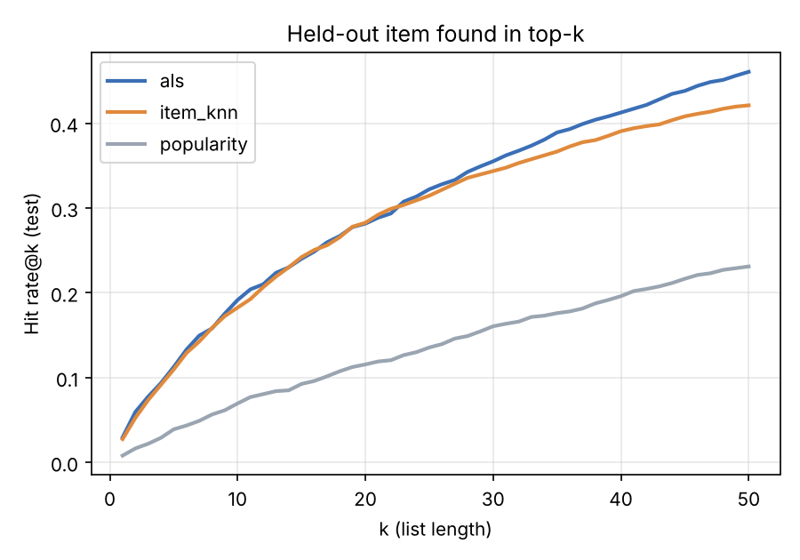
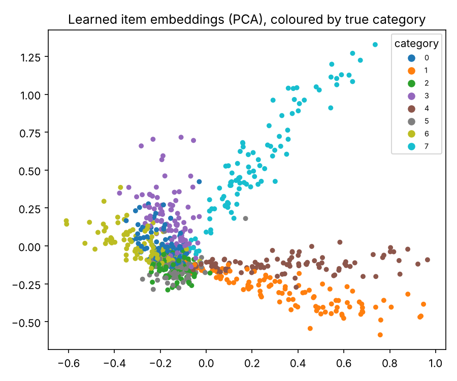

# recsys

[](https://github.com/YOUR_USERNAME/recsys/actions)


A production-style **recommender system** built from first principles: an implicit-feedback
**ALS matrix-factorisation** model written in NumPy, benchmarked against **item-kNN** and a
**popularity** baseline, with leakage-free temporal evaluation, cold-start handling, a CLI and a REST API.

No datasets to download, no API keys, no GPU. A seeded generator creates realistic interaction data
with known structure (latent item categories, user tastes, long-tail popularity), so you can verify the
model genuinely recovers the signal.

## Results

2,000 users, 800 items, about 60k interactions. Protocol: **leave-last-out**, the newest interaction per
user is the test item, the one before is the validation item. Hyper-parameters are tuned on validation,
the winner is chosen on validation, and test is reported once. Seen items are excluded from rankings.

| Model | Hit rate@10 | NDCG@10 | MRR | Catalogue coverage@10 |
|---|---|---|---|---|
| **ALS** (selected; 8 factors, reg 30, alpha 5) | **0.192** | **0.097** | 0.085 | 0.26 |
| Item-kNN (20 neighbours) | 0.183 | 0.092 | 0.080 | 0.28 |
| Popularity | 0.070 | 0.033 | 0.033 | 0.02 |

ALS is about **3x** the popularity baseline. ALS and item-kNN are close; the hit-rate curve shows ALS
pulling ahead at longer list lengths. Popularity recommends about 2% of the catalogue to everyone;
personalised models surface about a quarter of it. Reproduce with `recsys train` (about 30 s).

<p align="center">
  
  
</p>

The right plot shows learned item embeddings coloured by the *hidden* true category. The model was never
shown categories, yet it separates them.

## Features

- **From-scratch ALS** (Hu, Koren & Volinsky, 2008) for implicit feedback, with confidence weighting.
- **Three models, one interface** (`fit` / `score` / `similar_items`), so adding a model is about 20 lines.
- **Correct evaluation:** chronological leave-last-out, seen-item masking, tie-aware ranks, NDCG, MRR,
  hit rate, coverage; model selection on validation, never on test.
- **Production refit:** the chosen model is retrained on all interactions before serving.
- **Cold start:** unknown or empty users get popularity-based recommendations, flagged in the response.
- **Similar-items** endpoint from the learned embeddings.
- **FastAPI** service (`/recommend/{user_id}`, `/similar/{item_id}`, `/model`, `/health`), Docker image, CI matrix.
- 23 tests including leakage checks and an embedding-quality test (similar items share a category far above chance).

## Quick start

```bash
git clone https://github.com/YOUR_USERNAME/recsys.git && cd recsys
python -m venv .venv && source .venv/bin/activate
pip install -e ".[api,dev]"

recsys train                 # writes ./artifacts (model, metrics, plots)
recsys recommend 5 -k 10     # personalised top-10 for user 5
recsys recommend 999999      # cold-start user -> popularity
recsys similar 10 -k 5
recsys serve                 # http://127.0.0.1:8000/docs
```

```bash
curl "localhost:8000/recommend/5?k=3"
curl "localhost:8000/similar/10?k=3"
```

Docker: `docker build -t recsys . && docker run --rm -p 8000:8000 recsys`

## Project layout

```
src/recsys/
  data.py      synthetic generator, leave-last-out split, leakage-safe matrices
  models.py    Popularity, ItemKNN, ALS
  evaluate.py  ranking metrics
  train.py     tuning, selection, final refit, artifacts
  service.py   recommend / similar with cold-start fallback
  api.py       FastAPI app        cli.py   `recsys` command
configs/default.yaml   tests/   Dockerfile   Makefile   .github/workflows/ci.yml
```

## Using your own data

Replace `generate_data()` with a loader that returns a DataFrame with `user_id`, `item_id`, `timestamp`
(integer ids starting at 0) and an items table with `item_id`, `category`. Everything else is unchanged.

## Limitations

- The data is synthetic, so absolute scores say little about real catalogues; the comparison between models and the pipeline are the point.
- ALS solves users one at a time in NumPy: fine for tens of thousands of users, not millions. At that scale use a sparse/GPU implementation or approximate nearest-neighbour retrieval.
- Item-kNN stores a dense item-item matrix (O(items²) memory).
- Offline metrics are a proxy; real systems also need online A/B tests.

## License

MIT
